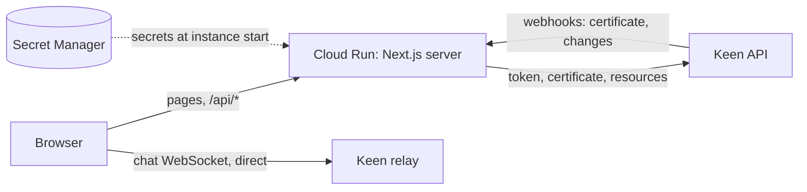

# Deploying the site to Cloud Run

How this site goes live on Google Cloud Run, end to end: what the app needed, how the
secrets are kept, how the service is shaped, how a custom domain is attached, and what
the Keen side must know about the site. Everything here was done for a real rollout;
the pitfalls section lists every wall we hit and what got us past it.

Placeholders used below:

| Placeholder                | Meaning                                                                               |
| -------------------------- | ------------------------------------------------------------------------------------- |
| `<project>`                | The GCP project that runs the service, its image and its secrets                      |
| `<dns-project>` / `<zone>` | The project and Cloud DNS zone that hold the domain's records                         |
| `<region>`                 | The Cloud Run region (must support domain mappings, see §6)                           |
| `<service>`                | The Cloud Run service name                                                            |
| `<site>`                   | The site's public origin, e.g. `https://app.example.com` (no path, no trailing slash) |
| `<parent-domain>`          | The domain you verify in Search Console, e.g. `example.com` or `sub.example.com`      |

All settings live in **`cli/config.sh`**. The scripts never take a value from anywhere
else.

## 1. The moving parts



- **Pages and `/api/*`** are served by the Next.js standalone server on Cloud Run.
- **The chat** is a WebSocket from the browser straight to the Keen relay. It never
  passes through Cloud Run.
- **The server talks to Keen** with an application token, a per-site certificate and
  the consumer contract / policy / spaces. It introduces itself with `KEEN_ORIGIN`.
- **Keen talks back with webhooks**: the certificate itself, and every change notice
  (spaces, agent settings, sign-outs).

## 2. What the app needed before it could run on Cloud Run

| Change                                                         | Why                                                                                                                                                                                                                                             |
| -------------------------------------------------------------- | ----------------------------------------------------------------------------------------------------------------------------------------------------------------------------------------------------------------------------------------------- |
| A complete `package-lock.json`                                 | `npm ci` inside the build image (a newer npm) refused the lock produced on a dev machine: optional native-binding entries differed. Regenerate the lock **inside** the build image (`npm install --package-lock-only`); versions stay the same. |
| `export const dynamic = 'force-dynamic'` on the `(app)` layout | Without it `next build` prerenders `/`, which reads the Keen connector: the build either fails without config or, worse, connects to live Keen from the build workers.                                                                          |
| Exit on missing config in production (`instrumentation.ts`)    | Next only logs an instrumentation error and keeps serving, so an instance without its Keen config would pass the health check and fail every page. Exiting lets Cloud Run refuse the revision.                                                  |
| Re-redeem the certificate every ~16 s while none has arrived   | During a rollout the certificate webhook can land on the OLD revision. A fresh code makes Keen send it again, to whichever instance now serves.                                                                                                 |
| Webhook answers 503 when the connector is not up yet           | Instead of an empty 500, so Keen's delivery log says what happened.                                                                                                                                                                             |
| A hidden tab pauses its long poll, and refreshes on return     | Billing is per open request (§4). One forgotten tab must not keep the instance running all day. On return the tab calls `router.refresh()`, which re-renders spaces, agents and settings and so covers any notice it missed.                    |
| The proxy holds a cold-start request up to 10 s                | After an idle spell the instance starts from zero; the first visitor waits for the connector (token → certificate → contract / policy / spaces) instead of seeing the maintenance page.                                                         |

## 3. Secrets never enter the image

- `.dockerignore` and `.gcloudignore` exclude every `.env*` file. This matters:
  **`next build` copies `.env` into `.next/standalone`**, so a stray `.env` would ship
  inside the image.
- The real secrets (the Keen client secret, the api key secret, the webhook URL
  secret `KEEN_WEBHOOK_SECRET`, optional third-party keys) live in **Secret Manager**,
  one secret each, in one region. The site refuses to boot without the webhook secret;
  generate it with `openssl rand -hex 32` and put the same value in the Keen webhook URL.
- The service runs as **its own service account**, which is granted
  `secretAccessor` **on each of its secrets**, never on the project. It can read
  nothing else.
- Each secret is mounted **pinned to a version number**, never `latest`. Every
  instance of a revision sees the same value, and a rotation is always a deliberate
  `secrets.sh` + `deploy.sh`.
- Addresses and ids (the Keen host, the relay URL, the client id, the api key id) are
  plain env vars: useless without the secrets. They are read from the local env file
  at deploy time, so they stay out of the repo too.
- `KEEN_ORIGIN` is **not** read from the env file. `deploy.sh` sets it to the site's
  public origin (`site_url` in `cli/config.sh`): the custom domain when one is set,
  otherwise the service's own deterministic `run.app` URL.
- Optional secrets are skipped while empty, and the feature that needs them reports
  "not configured" instead of failing the deploy.

Rotating the Keen client secret also signs every user out of Google Connect: the
encrypted Google refresh-token cookie is keyed from it.

## 4. The shape of the service

```
--min-instances 0 --max-instances 1
--cpu-throttling --cpu-boost --cpu 1 --memory 512Mi
--concurrency 1000 --timeout 300
--no-invoker-iam-check
```

- **At most one instance.** The connector's token, certificate and caches live in
  process memory, and so does the webhook → long-poll event bus. A second instance
  would receive webhooks meant for the first and never pass them to its own browsers.
- **Scale to zero, request-based billing.** Cloud Run bills, and gives CPU, only while
  a request is open. Every visible tab holds one long poll, so the instance runs
  exactly while someone has the site in front of them. Idle hours cost nothing; the
  free tier covers roughly the first fifty instance-hours a month.
- **`--cpu-boost`** shortens the cold start.
- **`--concurrency 1000`**: every visible tab holds a long poll for up to 25 s; the
  default 80 would cap the site at about 80 open tabs.
- **`--no-invoker-iam-check`** makes the service public. See §7 for why
  `--allow-unauthenticated` is not enough.

What a paused tab can miss: nothing addressed to its user while the instance lives
(those events queue per consumer until the next poll). A broadcast goes to whichever
tab polls first, and an instance that scaled to zero starts with an empty queue; the
refresh on return covers both.

## 5. The scripts

| Script              | When                                                                                                                                                                                                                                                                                                                                                                                                        |
| ------------------- | ----------------------------------------------------------------------------------------------------------------------------------------------------------------------------------------------------------------------------------------------------------------------------------------------------------------------------------------------------------------------------------------------------------- |
| `gcloud auth login` | Before any of the below. The token expires; non-interactive re-auth does not work.                                                                                                                                                                                                                                                                                                                          |
| `cli/secrets.sh`    | First time, and after any secret changes. Pushes the values from the local env file into Secret Manager. Values are never printed; a new version is added only when the value changed. Required secrets are all checked before anything is written.                                                                                                                                                         |
| `cli/deploy.sh`     | First time, after a secret rotation, after a domain change, or when an env value or runtime flag changes. Enables the APIs, grants Cloud Build its builder role, ensures the Artifact Registry repo, creates the service account and its per-secret access, builds from the `Dockerfile`, deploys with the full config, then (with a domain set) creates the domain mapping and the DNS record. Idempotent. |
| `cli/redeploy.sh`   | Every code update. Rebuilds and rolls a new revision; keeps everything `deploy.sh` set. Zero downtime.                                                                                                                                                                                                                                                                                                      |

To change **one env var** without rebuilding:

```bash
gcloud run services update <service> --region <region> --project <project> \
  --update-env-vars KEY=value
```

This rolls a new revision from the same image in about half a minute, with no
downtime. Then put the same value in `cli/config.sh` (or the env file), so the next
`deploy.sh` does not undo it.

## 6. Attaching a custom domain

A domain mapping makes Cloud Run serve the **same service under another name**. It is
not a redirect: the address bar keeps the custom domain, and the app's own redirects
stay on it.

**Why a CNAME and not an A record to an IP.** Cloud Run has no fixed IP of its own.
Google's front end recognises the service by the requested name, and issues a TLS
certificate only for a domain attached through a mapping. An A record pointing at some
Google IP reaches nothing and has no valid certificate. A fixed IP needs a paid
external load balancer, which this site does not need.

**Not every region supports domain mappings.** Pick one that does when you choose
`<region>`; the alternative is a load balancer.

### Step by step

1. **Verify ownership in Search Console**, as the account that will create the mapping.
    - Search Console → _Add a website_ → **Domain** (not URL prefix) →
      `<parent-domain>`.
    - Copy the `google-site-verification=…` value.
    - Add it as a **TXT record on `<parent-domain>`** in `<zone>`, TTL 300, the value in
      quotes. A TXT record sits next to an existing A record on the same name without
      touching it; browsers never read TXT, so a site already living there keeps
      working.
    - Wait until it resolves publicly (`dig +short TXT <parent-domain>`), then press
      **Verify**. `gcloud domains list-user-verified` should now list it.
    - Verify the **parent**, not the site's own name: the site's name will carry a
      CNAME, and DNS does not allow a CNAME next to any other record on the same name.
      A verified parent covers every name below it.
    - If someone else already owns the domain in Search Console, they can add you as an
      owner instead (Webmaster Central → the domain → _Add an owner_).
2. **Add the CNAME** in `<zone>`: the site's name → `ghs.googlehosted.com.` (trailing
   dot included), TTL 300. In the Cloud DNS console use _Add standard_; never edit an
   existing record to do it.
3. **Create the mapping**:

    ```bash
    gcloud beta run domain-mappings create --service <service> \
      --domain <site-host> --region <region> --project <project>
    ```

    (or Cloud Run → _Domain mappings_ → _Add mapping_). `deploy.sh` does steps 2 and 3
    itself when `DOMAIN` is set in `cli/config.sh` and you have write access to the zone.

4. **Move the origin**: `KEEN_ORIGIN` must become `<site>` (§5, one env var, or
   `deploy.sh` with `DOMAIN` set). Mapping alone is not enough: the server keeps
   introducing itself with the old origin.
5. **Wait for the certificate.** Google issues it on its own once the CNAME resolves,
   usually within 15 to 60 minutes; occasionally longer. Until then the browser shows
   `ERR_CONNECTION_CLOSED` for the custom domain. Watch it in Cloud Run → _Domain
   mappings_ (the status icon turns into a green check), or:

    ```bash
    gcloud beta run domain-mappings describe --domain <site-host> \
      --region <region> --project <project> \
      --format='value(status.conditions[1].type,status.conditions[1].status,status.conditions[1].message)'
    ```

    `CertificateProvisioned True` means done.

The service keeps answering on its own `run.app` URLs as well. Hand out only the
custom domain (§8 explains why the chat works on one origin only).

## 7. Public access under a domain-restricted org policy

If the organisation enforces `iam.allowedPolicyMemberDomains`, an `allUsers` invoker
binding is refused. `--allow-unauthenticated` then **only warns** ("Setting IAM policy
failed"), the deploy reports success, and every request gets **403**. Use
`--no-invoker-iam-check` instead: it turns the invoker check off for the service
without any IAM binding. An existing service can be switched with:

```bash
gcloud run services update <service> --region <region> --project <project> --no-invoker-iam-check
```

## 8. The Keen side

In the Keen admin console the site is described by a **webhook record** bound to the
site's **api key**:

| Field       | Value                                                                                  | Notes                                                                                                                                                                              |
| ----------- | -------------------------------------------------------------------------------------- | ---------------------------------------------------------------------------------------------------------------------------------------------------------------------------------- |
| Origin      | `<site>`                                                                               | Matched **exactly**: scheme, host and port; no path, no trailing slash. One record carries **one** origin, and an api key holds one record, so the key accepts exactly one origin. |
| Webhook URL | any HTTPS URL that reaches the service, plus `/api/keen-webhook/<KEEN_WEBHOOK_SECRET>` | Server to server; the origin plays no part. The service's own `run.app` URL works from the first minute and may stay for good.                                                     |

What the origin controls:

- **The server's calls.** The connector sends `KEEN_ORIGIN` as the `Origin` of its
  token request. A wrong origin does not get a clean error: Keen drops the connection
  and its proxy answers **502** with an HTML page. The site's log shows only
  `application_token attempt N failed`, and the site stays on the maintenance page.
- **The browser's chat.** The relay drops a WebSocket from any other origin. This is why
  the chat works on the custom domain only.
- **Links in e-mails.** Registration, password reset and password change links are
  built from `KEEN_ORIGIN` (`/confirmation`, `/set-password`, `/confirm-password`), so
  they follow the site wherever `KEEN_ORIGIN` points.

What the webhook controls: the certificate arrives **only** by webhook. If the URL is
unreachable (for example a custom domain whose TLS certificate is still pending), the
log shows the certificate claimed and redeemed (`200`, `201`) but never received, and
activation retries every ~16 s.

A healthy boot in the log reads:

```
[BOOT] application_token → HTTP 200
[BOOT] Certificate claim → HTTP 200
[BOOT] Certificate redeem → HTTP 201
[OK] Certificate received.
[keen] Resources: Consumer Policy → HTTP 200
[keen] Resources: Consumer Contract → HTTP 200
[BOOT] Application activated: true
```

Once Keen accepts the origin and can reach the webhook, nothing needs restarting: the
next request to the site completes the activation.

## 9. First rollout, in order

1. `gcloud auth login`.
2. Fill the local env file (never committed), including `KEEN_WEBHOOK_SECRET`
   (`openssl rand -hex 32`). Leave optional keys empty if you don't have them yet.
3. `./cli/secrets.sh`.
4. `./cli/deploy.sh` with `DOMAIN` empty. The site comes up on its `run.app` URL.
5. On Keen: the webhook record's origin = the `run.app` URL, webhook URL = the
   `run.app` URL + `/api/keen-webhook/<KEEN_WEBHOOK_SECRET>`. The site activates on the next request.
6. Verify the domain, add the CNAME, create the mapping (§6).
7. Switch the record's origin and `KEEN_ORIGIN` to the custom domain together (§5,
   §8). Leave the webhook on the `run.app` URL, or move it once the domain's
   certificate is green.
8. Set `DOMAIN` (and the DNS project / zone) in `cli/config.sh`, so the next
   `deploy.sh` keeps the origin.

## 10. Checking it

```bash
# pages: /maintenance answers at once; /login is 200 when the site is up,
# or held up to 10 s and sent to /maintenance when Keen is not reachable
curl -s -o /dev/null -w '%{http_code} %{time_total}s %{redirect_url}\n' <site>/login

# what the connector is doing
gcloud logging read 'resource.type="cloud_run_revision" AND resource.labels.service_name="<service>"' \
  --project <project> --freshness=15m --limit 40 --format='value(timestamp,textPayload)'

# did Keen's webhooks arrive?
gcloud logging read 'resource.type="cloud_run_revision" AND resource.labels.service_name="<service>" AND httpRequest.requestUrl:"keen-webhook"' \
  --project <project> --freshness=60m --format='value(timestamp,httpRequest.status)'

# what the service really runs with
gcloud run services describe <service> --region <region> --project <project>
```

To tell a Keen-side refusal from a site bug, send the token request yourself with
`curl` and the same `Origin` (secrets from the local env file, never echoed): `200`
means Keen accepts that origin, `502` means it does not.

## 11. Pitfalls we hit

| Symptom                                                     | Cause                                                          | Fix                                                                              |
| ----------------------------------------------------------- | -------------------------------------------------------------- | -------------------------------------------------------------------------------- |
| `npm ci` fails in the Docker build                          | Lockfile made by a different npm                               | Regenerate it inside the build image (§2)                                        |
| The build tries to reach Keen                               | `/` prerendered at build time                                  | `force-dynamic` on the `(app)` layout                                            |
| Deploy "succeeds", site answers 403                         | Org policy refuses `allUsers`                                  | `--no-invoker-iam-check` (§7)                                                    |
| Maintenance page; log: `application_token attempt N failed` | Origin not accepted by Keen (silent 502)                       | Put `<site>` in the webhook record's origin; it must equal `KEEN_ORIGIN` exactly |
| Token works, certificate never arrives                      | Webhook URL unreachable                                        | Point the webhook at a URL with a valid certificate (the `run.app` one)          |
| Custom domain: `ERR_CONNECTION_CLOSED`                      | Its TLS certificate is still being issued                      | Wait; watch _Domain mappings_ (§6)                                               |
| Mapping refused: domain not verified                        | The deploying account doesn't own the domain in Search Console | Verify the parent via TXT, or have an owner add you (§6)                         |
| Origin worked, then stopped                                 | Someone swapped the record's single origin                     | Keep one origin, the custom domain; the webhook URL is separate                  |
| One forgotten tab keeps the instance billed                 | A held long poll is an open request                            | Hidden tabs pause their poll (§2)                                                |

## 12. Known gaps

- **The chat does not reconnect on its own.** If its WebSocket drops (laptop sleep,
  network switch, a phone in the background, or an hour of silence on the relay's
  proxy), the prompt stays locked until the page is reloaded.
- **A sign-out sent while the instance was scaled to zero is lost.** The user then stays
  signed in until the token expires; the relay still checks the token on every chat
  frame.
- **Broadcasts are not versioned.** The first tab to poll takes them; the refresh on
  return covers the data, not the notice itself.
